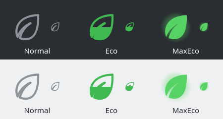

# MaxEco

**A three step slider in the system tray. Normal runs everything as usual, Eco cuts the power of the CPU and the graphics cards while games stay playable, and MaxEco puts them at the lowest power the hardware allows. Going back to Normal puts everything back exactly as it was.**

[Português (BR)](README.pt-BR.md)

Install in one line, on Arch, Debian, Ubuntu, Fedora, openSUSE and their derivatives:

```sh
curl -fsSL https://raw.githubusercontent.com/gabrielmf1998/MaxEco/main/install.sh | bash
```

The tray menu:

| Entry | What it does |
|---|---|
| **Normal**, **Eco**, **MaxEco** | The level, one of the three is always marked. The mouse wheel over the icon moves between them too, down toward MaxEco and up toward Normal |
| **60 Hz Screens in MaxEco** | Off by default. When checked, every screen faster than 60 Hz goes to 60 Hz while MaxEco is on. Changing the refresh rate makes the screens go black for a second or two, which is why it is optional |
| **Start With System** | Starts the tray icon at login. The level that was on when you logged out or shut down is applied again |
| **Quit** | Always goes back to Normal first, then closes the program |

The icon lights up with the level: switched off (a grey outline) in Normal, lit up to the middle in Eco, fully lit with a glow in MaxEco. It never blinks or animates.



## What each level changes

| Part | Eco | MaxEco |
|---|---|---|
| CPU (any cpufreq driver: amd-pstate, intel_pstate, acpi-cpufreq) | governor `powersave`, energy preference `balance_power`, maximum frequency 60 % of the highest one (3.16 GHz on a Ryzen 7 9800X3D, so no turbo) | governor `powersave`, energy preference `power`, maximum frequency = the lowest one |
| AMD graphics (amdgpu) | power cap at 60 % of its default. A card with no screen and no power cap (an unused integrated GPU) goes to `low` | `power_dpm_force_performance_level = low` |
| NVIDIA graphics (through NVML, the driver's own library) | power limit at 60 % of the default (never under the card's minimum), graphics clock up to 60 % of the highest, memory clock up to 75 % | power limit at its minimum, graphics and memory clocks locked at their lowest values |
| Motherboard fans (Nuvoton nct67xx chips, found on most ASUS, MSI and ASRock boards) | every spinning fan gets a quiet curve written into the chip itself, following the CPU temperature: 35 % up to 55 °C, 60 % at 70 °C, 100 % from 80 °C | the same curve |
| NVIDIA fans | left as they were | left as they were |
| Screens | not touched | not touched, or 60 Hz with the option above |

Eco never raises a limit. When something was already set lower (by you or another tool), it stays where it was.

Switching between Eco and MaxEco goes straight from one to the other, without passing through Normal, and a fan curve that is already running is not written again.

Before changing anything, the root helper writes the current values to `/run/maxeco/state`. **Normal** writes them back. `/run` lives in memory, so a reboot (or a power cut) always starts clean: nothing is changed on disk.

The fan curves run inside the fan chip, not in a program, so they keep speeding the fans up if something heats up even if MaxEco is closed or stuck. A chip that refuses the curve gets its fan back at 100 %.

The graphics card fans are left alone on purpose. NVML reports 30 % as the lowest speed of an RTX 3060 Ti, but at 30 % its fans do not spin at all (0 RPM, measured), so a fixed low speed is not safe. The card's own automatic curve is not quiet either: it held 53 % at 46 °C, louder than the 47 % the owner already had. Both levels draw less than Normal, so the fans you already use are enough.

Screens are the only part KDE remembers across a reboot, so when the 60 Hz option is used the tray keeps their previous modes in `~/.config/maxeco/display`. If the PC is turned off in MaxEco with screens at 60 Hz, the next login puts them back (the tray does it when it starts with the system, otherwise a small autostart entry, `maxeco --restore-display`, that removes itself afterwards). GNOME has no command line tool for this, so there the option does nothing.

Not touched on purpose: the power-profiles-daemon profile, the boost/turbo switch (power-profiles-daemon writes the per core boost files itself, and the frequency limit already rules out turbo), PCIe ASPM, and USB power saving.

### Measured

Ryzen 7 9800X3D + RTX 3060 Ti, Roblox open in the background (a light scene), averages over 8 seconds:

| | Normal | Eco | MaxEco |
|---|---|---|---|
| CPU package (RAPL) | 38.8 W | 28.5 W | 23.9 W |
| GPU (NVML) | 106.5 W | 57.1 W | 33.7 W |
| GPU busy | 16 % | 31 % | 98 % |

In MaxEco the graphics card works at 98 % just to show that light scene, which is why games crawl there (about 30 FPS in Roblox). Eco leaves it plenty of room. With Roblox in front and moving, MaxEco took the GPU from 164.9 W to 32.4 W.

The CPU number cannot go much lower on this chip: most of the 24 W is the I/O die, the cores themselves drop to 0.2 W in MaxEco.

## How light is it

The tray program is written in C **without any C library**: its own system calls, its own minimal D-Bus client and nothing else. The binary has 37 KB.

| | |
|---|---|
| Memory (RSS, PSS and private are all equal) | 60 to 64 KB |
| CPU while idle | 0 (it sleeps in `ppoll()` and only wakes up when the tray host talks to it) |
| Wakeups while idle | 0 (measured on the running tray over 3 minutes: 0 context switches, 0 ns of CPU) |

The icon costs the panel nothing either. It is always reported as *Active* (Plasma only pulses tray icons that ask for attention), it is a plain SVG with no animation, and the panel is told to redraw it only when the level really changes.

The root part (`maxeco-helper`) only runs for a fraction of a second when the level changes (about 0.2 s on the PC above).

## Requirements

Linux on x86_64 with systemd and polkit 0.106 or newer (the version that reads JavaScript rules), glibc 2.34 or newer, and a tray that speaks StatusNotifierItem: KDE Plasma out of the box, GNOME with the *AppIndicator and KStatusNotifierItem Support* extension, and most other panels. For other architectures build from source with `make LIBC=1` (same program, linked to the C library, about 1.8 MB RSS because of the shared library).

## Install

```sh
curl -fsSL https://raw.githubusercontent.com/gabrielmf1998/MaxEco/main/install.sh | bash
```

The installer takes the package for your distro from the latest release, installs it only if its sha256 matches the release's `SHA256SUMS`, and uses the distro's own package manager (pacman, apt, dnf, zypper or rpm-ostree). It asks for the password once, with sudo in a terminal or the desktop's password dialog otherwise, and then starts the tray icon. Running it again updates MaxEco and keeps the level that was on.

Options go on the bash side of the pipe, for example `curl -fsSL .../install.sh | MAXECO_MIRROR=gitlab bash`:

| Option | What it does |
|---|---|
| `MAXECO_MIRROR=gitlab` | downloads from the [GitLab mirror](https://gitlab.com/gabriel17166/MaxEco) instead of GitHub |
| `MAXECO_VERSION=1.2.0` | installs that release instead of the latest one |
| `MAXECO_FORMAT=deb` | forces the package type (`arch`, `deb` or `rpm`) |
| `MAXECO_NO_START=1` | does not start the tray icon at the end |

Or download the package yourself from [Releases](https://github.com/gabrielmf1998/MaxEco/releases/latest):

| Distro | File | Install | Remove |
|---|---|---|---|
| Arch, CachyOS, Manjaro, EndeavourOS | `maxeco-1.2.1-1-x86_64.pkg.tar.zst` | `sudo pacman -U ./maxeco-1.2.1-1-x86_64.pkg.tar.zst` | `sudo pacman -R maxeco` |
| Debian, Ubuntu, Mint, Pop!_OS | `maxeco_1.2.1-1_amd64.deb` | `sudo apt install ./maxeco_1.2.1-1_amd64.deb` | `sudo apt remove maxeco` |
| Fedora, Nobara | `maxeco-1.2.1-1.x86_64.rpm` | `sudo dnf install ./maxeco-1.2.1-1.x86_64.rpm` | `sudo dnf remove maxeco` |
| openSUSE | `maxeco-1.2.1-1.x86_64.rpm` | `sudo zypper install --allow-unsigned-rpm ./maxeco-1.2.1-1.x86_64.rpm` | `sudo zypper remove maxeco` |
| Bazzite, Silverblue, Kinoite | `maxeco-1.2.1-1.x86_64.rpm` | `rpm-ostree install ./maxeco-1.2.1-1.x86_64.rpm`, then reboot | `rpm-ostree uninstall maxeco` |

`SHA256SUMS` in the same release has the checksum of every file. Removing the package goes back to Normal first.

From source (any distro, also how the packages are made):

```sh
make
sudo make install PREFIX=/usr
sudo systemctl daemon-reload
```

`packaging/build.sh` builds the source tarball, the three packages and `SHA256SUMS` into `dist/`, without root and on any distro (the `.deb` needs `dpkg-deb`, the `.rpm` needs `rpmbuild`).

Then open **MaxEco** from the application menu.

## How it works

```
tray (maxeco, user)
  Eco     systemctl start maxeco-level@eco.service ─┐  both first pull in maxeco.service:
  MaxEco  systemctl start maxeco-level@max.service ─┘    ExecStart = maxeco-helper save
  Normal  systemctl stop maxeco.service                  ExecStop  = maxeco-helper off

maxeco-level@eco.service / @max.service (root, oneshot)
  ExecStart = maxeco-helper level eco / level max
```

`/usr/share/polkit-1/rules.d/50-maxeco.rules` lets the user sitting at the machine start `maxeco-level@eco.service` and `maxeco-level@max.service` and start and stop `maxeco.service`, and nothing else, without a password. The helper keeps the current level in `/run/maxeco/level`, and `maxeco-resume.service` applies it again after a suspend, because graphics drivers forget clock locks while the card is powered off.

If another tool also tunes the GPU or the fans (an overclock service, a fan control panel), it must not fight MaxEco. `contrib/max-desempenho/` has the drop-ins used with max-desempenho and PC Panel: the fan panel is paused while Eco or MaxEco is on, and both run again after going back to Normal.

## Tests

```sh
tests/t_helper.sh                                          # helper against a fake sysfs tree (CPU, GPUs, fan chips), both levels
dbus-run-session -- python3 -I tests/t_tray.py build/maxeco  # tray on a private bus, fake tray host, systemctl and kscreen-doctor
tests/t_install.sh                                         # install.sh with fake curl, sudo and package managers, after packaging/build.sh
```

Neither touches the real machine.

## License

MIT
