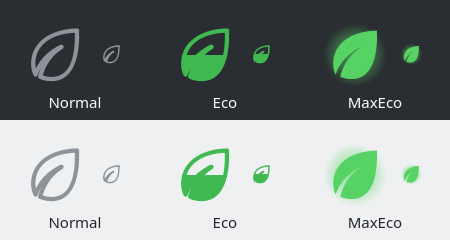

# MaxEco

**Um slider de três posições na bandeja do sistema. O Normal deixa tudo como sempre, o Eco corta o consumo do processador e das placas de vídeo e ainda deixa jogar, e o MaxEco coloca os dois no menor consumo que o hardware aceita. Voltar pro Normal devolve tudo exatamente como estava.**

[English](README.md)

Instalação numa linha só, no Arch, Debian, Ubuntu, Fedora, openSUSE e derivados:

```sh
curl -fsSL https://raw.githubusercontent.com/gabrielmf1998/MaxEco/main/install.sh | bash
```

O menu da bandeja:

| Opção | O que faz |
|---|---|
| **Normal**, **Eco**, **MaxEco** | O nível, sempre um dos três fica marcado. A rodinha do mouse em cima do ícone também troca, pra baixo vai em direção ao MaxEco e pra cima em direção ao Normal |
| **60 Hz Screens in MaxEco** | Desmarcada por padrão. Marcada, todo monitor acima de 60 Hz vai pra 60 Hz enquanto o MaxEco estiver ligado. Trocar a taxa deixa a tela preta por um ou dois segundos, por isso é opcional |
| **Start With System** | Abre o ícone junto com o login. O nível que estava ligado quando você saiu ou desligou o PC volta sozinho |
| **Quit** | Sempre volta pro Normal primeiro e depois fecha o programa |

O ícone acende conforme o nível. Apagado (só o contorno cinza) no Normal, aceso até a metade no Eco e todo aceso, com brilho, no MaxEco. Ele nunca pisca nem tem animação.



## O que cada nível muda

| Parte | Eco | MaxEco |
|---|---|---|
| Processador (qualquer driver cpufreq, amd-pstate, intel_pstate, acpi-cpufreq) | governor `powersave`, preferência de energia `balance_power`, frequência máxima em 60 % da maior (3,16 GHz num Ryzen 7 9800X3D, então sem turbo) | governor `powersave`, preferência de energia `power`, frequência máxima = a menor |
| Vídeo AMD (amdgpu) | limite de energia em 60 % do padrão. Uma placa sem monitor e sem limite de energia (um vídeo integrado parado) vai pra `low` | `power_dpm_force_performance_level = low` |
| Vídeo NVIDIA (pela NVML, a biblioteca do próprio driver) | limite de energia em 60 % do padrão (nunca abaixo do mínimo da placa), clock do núcleo até 60 % do maior, clock da memória até 75 % | limite de energia no mínimo, clocks de núcleo e memória travados nos menores valores |
| Fans da placa-mãe (chips Nuvoton nct67xx, da maioria das placas ASUS, MSI e ASRock) | cada fan que está girando ganha uma curva silenciosa gravada no próprio chip, seguindo a temperatura do processador. 35 % até 55 °C, 60 % em 70 °C, 100 % a partir de 80 °C | a mesma curva |
| Fans da placa de vídeo NVIDIA | ficam como estavam | ficam como estavam |
| Monitores | não mexe | não mexe, ou 60 Hz com a opção acima |

O Eco nunca aumenta um limite. Se algo já estava mais baixo (por você ou por outro programa), fica onde estava.

Trocar entre Eco e MaxEco vai direto de um pro outro, sem passar pelo Normal, e uma curva de fan que já está rodando não é gravada de novo.

Antes de mudar qualquer coisa, o helper root grava os valores atuais em `/run/maxeco/state`. O **Normal** escreve esses valores de volta. O `/run` fica na memória, então um reboot (ou queda de luz) sempre começa limpo, nada é alterado no disco.

As curvas das fans rodam dentro do chip das fans, não num programa. Então elas continuam acelerando as fans se algo esquentar, mesmo com o MaxEco fechado ou travado. Se o chip recusar a curva, aquela fan volta para 100 %.

As fans da placa de vídeo ficam de fora de propósito. A NVML informa 30 % como a menor velocidade de uma RTX 3060 Ti, mas em 30 % as fans dela nem giram (0 RPM, medido), então uma velocidade fixa baixa não é segura. A curva automática da própria placa também não é silenciosa, ela ficou em 53 % com a GPU a 46 °C, mais alto que os 47 % que o dono já usava. Os dois níveis gastam menos que o Normal, então as fans que você já usa dão conta.

Os monitores são a única parte que o KDE lembra depois de um reboot. Por isso, quando a opção de 60 Hz é usada, a bandeja guarda os modos anteriores em `~/.config/maxeco/display`. Se o PC for desligado no MaxEco com os monitores em 60 Hz, o próximo login devolve os modos (a bandeja faz isso quando abre junto com o sistema, senão uma pequena entrada de autostart, `maxeco --restore-display`, que se apaga depois). O GNOME não tem uma ferramenta de linha de comando para isso, então lá a opção não faz nada.

Não mexe, de propósito, no perfil do power-profiles-daemon, na chave de boost/turbo (o power-profiles-daemon escreve o boost de cada núcleo por conta própria, e o limite de frequência já impede o turbo), no ASPM do PCIe nem na economia de energia do USB.

### Medido

Ryzen 7 9800X3D + RTX 3060 Ti, com o Roblox aberto em segundo plano (uma cena leve), média de 8 segundos:

| | Normal | Eco | MaxEco |
|---|---|---|---|
| Processador, pacote inteiro (RAPL) | 38,8 W | 28,5 W | 23,9 W |
| Placa de vídeo (NVML) | 106,5 W | 57,1 W | 33,7 W |
| Uso da placa de vídeo | 16 % | 31 % | 98 % |

No MaxEco a placa de vídeo trabalha a 98 % só pra mostrar essa cena leve, por isso os jogos ficam lentos nele (uns 30 FPS no Roblox). O Eco deixa bastante folga. Com o Roblox na frente e em movimento, o MaxEco levou a placa de 164,9 W para 32,4 W.

O número do processador não desce muito mais nesse chip, a maior parte dos 24 W é o die de I/O. Os núcleos em si caem para 0,2 W no MaxEco.

## Quanto pesa

A bandeja é escrita em C **sem nenhuma biblioteca C**, com chamadas de sistema próprias, um cliente D-Bus mínimo próprio e nada mais. O binário tem 37 KB.

| | |
|---|---|
| Memória (RSS, PSS e privada são iguais) | 60 a 64 KB |
| CPU parado | 0 (dorme em `ppoll()` e só acorda quando a bandeja do sistema fala com ele) |
| Vezes que acorda parado | 0 (medido no ícone rodando, por 3 minutos, 0 trocas de contexto e 0 ns de CPU) |

O ícone também não custa nada pro painel. Ele sempre se apresenta como *Active* (o Plasma só faz pulsar ícones que pedem atenção), é um SVG simples sem animação, e o painel só é avisado pra redesenhar quando o nível muda de verdade.

A parte root (`maxeco-helper`) só roda por uma fração de segundo na hora de trocar de nível (uns 0,2 s no PC acima).

## Requisitos

Linux x86_64 com systemd, polkit 0.106 ou mais novo (a versão que lê regras em JavaScript), glibc 2.34 ou mais nova, e uma bandeja que fale StatusNotifierItem. O KDE Plasma já vem pronto, o GNOME precisa da extensão *AppIndicator and KStatusNotifierItem Support*, e a maioria dos outros painéis funciona. Em outras arquiteturas compile da fonte com `make LIBC=1` (mesmo programa, ligado à biblioteca C, cerca de 1,8 MB de RSS por causa da biblioteca compartilhada).

## Instalar

```sh
curl -fsSL https://raw.githubusercontent.com/gabrielmf1998/MaxEco/main/install.sh | bash
```

O instalador pega o pacote da sua distro na última release, só instala se o sha256 bater com o `SHA256SUMS` da release, e usa o gerenciador de pacotes da própria distro (pacman, apt, dnf, zypper ou rpm-ostree). Ele pede a senha uma vez, pelo sudo no terminal ou pela janela de senha do desktop, e depois abre o ícone na bandeja. Rodar de novo atualiza o MaxEco e mantém o nível que estava ligado.

As opções vão do lado do bash, por exemplo `curl -fsSL .../install.sh | MAXECO_MIRROR=gitlab bash`:

| Opção | O que faz |
|---|---|
| `MAXECO_MIRROR=gitlab` | baixa do [espelho no GitLab](https://gitlab.com/gabriel17166/MaxEco) em vez do GitHub |
| `MAXECO_VERSION=1.2.0` | instala essa release em vez da última |
| `MAXECO_FORMAT=deb` | força o tipo de pacote (`arch`, `deb` ou `rpm`) |
| `MAXECO_NO_START=1` | não abre o ícone na bandeja no final |

Ou baixe o pacote você mesmo em [Releases](https://github.com/gabrielmf1998/MaxEco/releases/latest):

| Distro | Arquivo | Instalar | Remover |
|---|---|---|---|
| Arch, CachyOS, Manjaro, EndeavourOS | `maxeco-1.2.1-1-x86_64.pkg.tar.zst` | `sudo pacman -U ./maxeco-1.2.1-1-x86_64.pkg.tar.zst` | `sudo pacman -R maxeco` |
| Debian, Ubuntu, Mint, Pop!_OS | `maxeco_1.2.1-1_amd64.deb` | `sudo apt install ./maxeco_1.2.1-1_amd64.deb` | `sudo apt remove maxeco` |
| Fedora, Nobara | `maxeco-1.2.1-1.x86_64.rpm` | `sudo dnf install ./maxeco-1.2.1-1.x86_64.rpm` | `sudo dnf remove maxeco` |
| openSUSE | `maxeco-1.2.1-1.x86_64.rpm` | `sudo zypper install --allow-unsigned-rpm ./maxeco-1.2.1-1.x86_64.rpm` | `sudo zypper remove maxeco` |
| Bazzite, Silverblue, Kinoite | `maxeco-1.2.1-1.x86_64.rpm` | `rpm-ostree install ./maxeco-1.2.1-1.x86_64.rpm` e reiniciar | `rpm-ostree uninstall maxeco` |

O `SHA256SUMS` da mesma release tem o checksum de cada arquivo. Remover o pacote volta pro Normal antes.

Da fonte (qualquer distro, é também como os pacotes são feitos):

```sh
make
sudo make install PREFIX=/usr
sudo systemctl daemon-reload
```

O `packaging/build.sh` gera o tarball da fonte, os três pacotes e o `SHA256SUMS` em `dist/`, sem root e em qualquer distro (o `.deb` precisa do `dpkg-deb`, o `.rpm` precisa do `rpmbuild`).

Depois abra o **MaxEco** pelo menu de aplicativos.

## Como funciona

```
bandeja (maxeco, usuário)
  Eco     systemctl start maxeco-level@eco.service ─┐  os dois puxam antes o maxeco.service
  MaxEco  systemctl start maxeco-level@max.service ─┘    ExecStart = maxeco-helper save
  Normal  systemctl stop maxeco.service                  ExecStop  = maxeco-helper off

maxeco-level@eco.service / @max.service (root, oneshot)
  ExecStart = maxeco-helper level eco / level max
```

O `/usr/share/polkit-1/rules.d/50-maxeco.rules` deixa quem está sentado na máquina iniciar o `maxeco-level@eco.service` e o `maxeco-level@max.service` e iniciar e parar o `maxeco.service`, e nada além disso, sem senha. O helper guarda o nível atual em `/run/maxeco/level`, e o `maxeco-resume.service` reaplica esse nível depois de uma suspensão, porque os drivers de vídeo esquecem as travas de clock enquanto a placa fica desligada.

Se outra ferramenta também ajusta a GPU ou as fans (um serviço de overclock, um painel de fans), ela não pode brigar com o MaxEco. Em `contrib/max-desempenho/` estão os drop-ins usados com o max-desempenho e o PC Panel. O painel de fans fica pausado enquanto o Eco ou o MaxEco estiver ligado, e os dois rodam de novo quando volta pro Normal.

## Testes

```sh
tests/t_helper.sh                                          # helper contra um sysfs falso (processador, vídeo, chips de fan), nos dois níveis
dbus-run-session -- python3 -I tests/t_tray.py build/maxeco  # bandeja num barramento privado, com bandeja, systemctl e kscreen-doctor falsos
tests/t_install.sh                                         # install.sh com curl, sudo e gerenciadores de pacote falsos, depois do packaging/build.sh
```

Nenhum dos dois mexe na máquina de verdade.

## Licença

MIT
